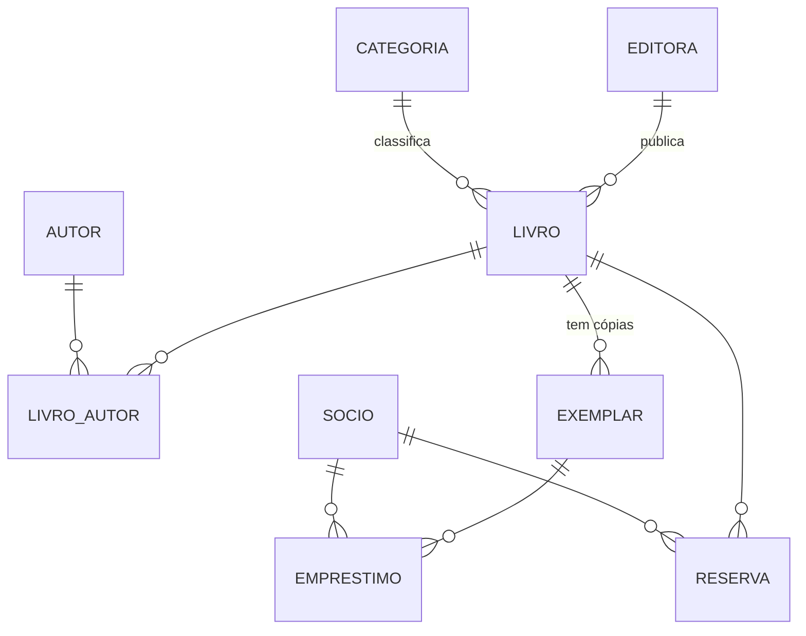

# Biblioteca Comunitária

Aplicação web em **Yesod (Haskell)** para gerenciar uma biblioteca comunitária: acervo, exemplares, sócios, empréstimos com multa por atraso e reservas. Arquitetura monolítica (Opção A do enunciado), com páginas em Shakespearean Templates (Hamlet e Lucius).

## Funcionalidades

- CRUD de livros, autores, editoras, categorias, exemplares, sócios, empréstimos e reservas pela interface web.
- **Importação de livro por ISBN** pela Open Library: título, autores, editora, ano, capa e trecho são gravados; editora e autores existentes são reaproveitados.
- **Endereço do sócio pelo CEP** via ViaCEP, gravado no cadastro.
- Empréstimo com prazo de 14 dias, limite de 3 abertos por sócio, multa de R$ 1,00 por dia de atraso e bloqueio de exemplar perdido ou já emprestado.
- Reservas para livros sem exemplar disponível, atendidas automaticamente no empréstimo, com aviso da fila na devolução.
- Busca de livros por título e categoria; filtros de empréstimos (abertos, atrasados, devolvidos).
- Validação de formulários com mensagens em português, proteção CSRF em todo POST e páginas de erro próprias.

## Tecnologias

| Camada | Ferramenta |
|---|---|
| Linguagem e framework | Haskell (GHC 9.10.3), Yesod 1.6 |
| Templates | Hamlet (HTML), Lucius (CSS), Bootstrap 3 |
| Banco | PostgreSQL 16, via Persistent (`persistent-postgresql`) |
| HTTP para as APIs | `http-conduit` + `aeson` |
| Build | Stack (snapshot lts-24.67, com warp 3.4.17 por segurança) |
| Testes | `hspec` + `yesod-test` |
| Ambiente | Docker Compose (Postgres), GitHub Actions (CI) |

## Como executar

Pré-requisitos: [Stack](https://docs.haskellstack.org/), Docker e a biblioteca cliente do Postgres (`sudo apt install libpq-dev` no Ubuntu/Debian).

```bash
docker compose up -d          # Postgres na porta 5433, bancos biblioteca e biblioteca_test
stack build                   # o primeiro build baixa o GHC e compila as dependências (demora)
stack exec biblioteca-seed    # opcional: dados de exemplo, só se o banco estiver vazio
stack exec biblioteca         # http://localhost:3000
```

- Testes: `stack test`.
- Recarregar ao editar: `stack install yesod-bin` e depois `stack exec -- yesod devel`.
- Outro banco: defina `YESOD_PGHOST`, `YESOD_PGPORT`, `YESOD_PGUSER`, `YESOD_PGPASS` e `YESOD_PGDATABASE` (veja `.env.example`).

## Banco de dados

Nove tabelas do domínio, definidas em `config/models.persistentmodels` e criadas pela migração automática do Persistent ao subir a aplicação. (`user` e `email` vêm do scaffold do Yesod e não são usadas pelo domínio.)

| Tabela | Para que serve |
|---|---|
| `autor` | Autores, com nacionalidade |
| `editora` | Editoras (nome único) |
| `categoria` | Gêneros do acervo (nome único) |
| `livro` | A obra: título, ISBN (único), ano, sinopse, capa; FK para editora (opcional) e categoria |
| `livro_autor` | Junção N:N entre livro e autor, chave primária composta |
| `exemplar` | Cópia física de um livro: código único, estado (Bom, Danificado, Perdido) e disponibilidade |
| `socio` | Quem pega emprestado: e-mail único, telefone, CEP e endereço vindo do ViaCEP |
| `emprestimo` | Exemplar + sócio, datas de empréstimo, prevista e de devolução, multa em centavos |
| `reserva` | Fila de espera de sócio por livro, com status (Ativa, Atendida, Cancelada) |



As FKs são `ON DELETE RESTRICT` (o banco impede apagar o que ainda é referenciado), exceto `livro_autor → livro`, que é `CASCADE`.

## Integração com APIs

| API | Uso | Onde no código |
|---|---|---|
| [Open Library](https://openlibrary.org/dev/docs/api/books) | Em **Livros → Importar por ISBN**: busca o livro e grava título, autores, editora, ano, capa e trecho | `src/Integracao/OpenLibrary.hs`, `src/Handler/LivroImportar.hs` |
| [ViaCEP](https://viacep.com.br/) | No cadastro de **sócio**: com o CEP, grava logradouro, bairro, cidade e UF | `src/Integracao/ViaCep.hs`, `src/Handler/Socio.hs` |

Falhas de rede, timeout, ISBN ou CEP inexistente e respostas inesperadas viram mensagens para o usuário, sem erro 500.

## Organização do código

```
config/models.persistentmodels   entidades do banco
config/routes.yesodroutes        rotas
src/Handler/*.hs                 um módulo de handlers por entidade
src/Regras/*.hs                  regras de empréstimo e reserva, testáveis sem HTTP
src/Integracao/*.hs              clientes da Open Library e do ViaCEP
src/Form/Comum.hs                campos e páginas de formulário compartilhados
templates/                       Hamlet e Lucius por entidade
test/                            testes de handlers, regras e integrações
```

## Integrante

Trabalho individual: Leonardo (`leonardosf98`) — modelagem, backend Yesod, integrações, testes e documentação.

O planejamento por fases está no [ROADMAP.md](ROADMAP.md).
