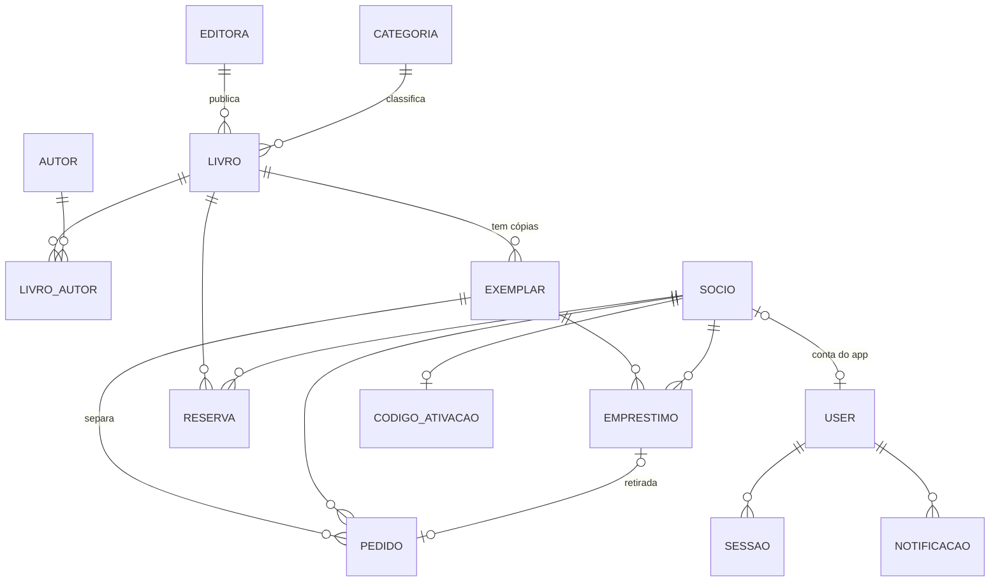

# Biblioteca Comunitária

Sistema de uma biblioteca comunitária com **backend em Yesod (Haskell)** e frontend em Next.js: acervo, exemplares, sócios, empréstimos com multa por atraso, pedidos pelo app com retirada no balcão e fila de reservas. Segue a **Opção B** do enunciado: o Yesod expõe uma API REST em JSON e o frontend fica separado, em `web/`.

A versão monolítica com Hamlet, entregue primeiro, continua disponível na tag [`v1.0.0`](../../tree/v1.0.0).

```
Navegador ──> Next.js (BFF) ──Bearer──> API Yesod ──> PostgreSQL
                │                          ├─ Open Library (ISBN)
                └─ cookie httpOnly         └─ ViaCEP (endereço)
```

O navegador só fala com o Next.js; o Next.js chama a API pelo servidor e guarda o token num cookie `httpOnly`. A API não usa cookie nem sessão: cada requisição traz `Authorization: Bearer <token>`.

## Funcionalidades

**Sócio** (área pública e "Meus empréstimos"):
- catálogo com capas, busca por título, autor ou ISBN e filtro por categoria;
- pedido de empréstimo pelo app, com código de retirada válido por 48 h, e entrada na fila quando não há exemplar livre;
- renovação única de 7 dias, cancelamento de pedido, saída da fila e histórico com multas;
- ativação da conta com o código entregue no balcão (sem cadastro aberto).

**Bibliotecário** (`/painel`):
- números do dia, pedidos para separar, atrasados com multa prevista e devoluções do dia;
- balcão com empréstimo em 3 passos e devolução rápida pelo código do exemplar;
- cadastro de sócios (endereço pelo **ViaCEP**), código de ativação e registro de pagamento de multa;
- acervo: livros, exemplares, autores, editoras, categorias e **importação por ISBN** pela Open Library.

**Regras** (na API, com testes): limite de 3 livros por sócio (empréstimos e pedidos), multa de R$ 1,00 por dia, multa não paga ou atraso bloqueiam pedidos e renovações, fila de reservas respeitada, pedido não retirado expira em 48 h, exemplar perdido fora da disponibilidade.

## Tecnologias

| Camada | Ferramenta |
|---|---|
| Backend | Haskell (GHC 9.10.3), Yesod 1.6, API JSON |
| Banco | PostgreSQL 16, via Persistent (`persistent-postgresql`) |
| Autenticação | senhas com hash (`yesod-auth-hashdb`), token opaco por sessão, só o hash SHA-256 no banco |
| HTTP para as APIs externas | `http-conduit` + `aeson` |
| Frontend | Next.js 16 (App Router), React 19, Tailwind 4 |
| Build | Stack (snapshot lts-24.67) e npm |
| Testes | `hspec` + `yesod-test` |
| Ambiente | Docker Compose (Postgres), GitHub Actions (HLint, Semgrep, testes, auditoria OSV, build do frontend) |

## Como executar

Pré-requisitos: [Stack](https://docs.haskellstack.org/), Node 24, Docker e a biblioteca cliente do Postgres (`sudo apt install libpq-dev` no Ubuntu/Debian).

```bash
docker compose up -d          # Postgres na porta 5433, bancos biblioteca e biblioteca_test
stack build                   # o primeiro build baixa o GHC e compila as dependências (demora)
stack exec biblioteca-seed    # opcional: dados de exemplo; pode rodar de novo sem duplicar
stack exec biblioteca         # API em http://localhost:3000
stack exec biblioteca-rotina  # uma passada da rotina: expira pedidos, anda a fila e gera os avisos por horário

cd web && npm ci && npm run dev   # frontend em http://localhost:3001 (API_URL, padrão http://localhost:3000)
```

O seed traz 68 livros: obras em domínio público do [Project Gutenberg](https://www.gutenberg.org/) e alguns títulos de ficção científica e técnicos. As capas ficam em `web/public/capas/` e vêm da [Open Library](https://openlibrary.org/).

Para criar ou trocar a senha de um bibliotecário:

```bash
stack exec biblioteca-usuario -- maria   # pede a senha (mínimo 8 caracteres) sem mostrar na tela
echo "$SENHA" | stack exec biblioteca-usuario -- maria   # em script, a senha vem pela entrada padrão
```

Sócios são cadastrados pelo bibliotecário no painel; o sócio recebe um código e cria a própria senha em `/ativar`.

- Testes: `stack test`.
- Outro banco: defina `YESOD_PGHOST`, `YESOD_PGPORT`, `YESOD_PGUSER`, `YESOD_PGPASS` e `YESOD_PGDATABASE` (veja `.env.example`).

## Deploy

A cada push na `main`, a action **Imagens** publica no GHCR `ghcr.io/leonardosf98/biblioteca-api` (binários do Stack sobre Ubuntu 24.04) e `ghcr.io/leonardosf98/biblioteca-web` (Next em modo `standalone`), com as tags `latest` e o SHA curto do commit.

Em produção, uma máquina com Docker roda `deploy/docker-compose.yml`: Postgres, API, rotina, Next e Caddy. Só o Caddy expõe portas para fora (80 e 443), e o certificado HTTPS é emitido sozinho para o `DOMINIO`. A API escuta só em `127.0.0.1:3000` da máquina (para o Postman por túnel SSH, veja `postman/README.md`) e o banco fica só na rede do compose.

O serviço `rotina` usa a mesma imagem da API e roda `biblioteca-rotina` a cada 5 minutos: expira pedidos vencidos, entrega exemplares livres ao primeiro da fila e gera os avisos `pedido_expirando`, `devolucao_vencendo` e `emprestimo_atrasado`. A chave única das notificações impede aviso repetido. Para disparar na hora (numa apresentação, por exemplo): `docker compose run --rm api biblioteca-rotina`.

```bash
mkdir biblioteca && cd biblioteca
curl -fsSLO https://raw.githubusercontent.com/leonardosf98/yesod-biblioteca/main/deploy/docker-compose.yml
curl -fsSLO https://raw.githubusercontent.com/leonardosf98/yesod-biblioteca/main/deploy/Caddyfile
printf 'DOMINIO=library.leonardosouza.dev\nPOSTGRES_PASSWORD=%s\n' "$(openssl rand -hex 24)" > .env
docker compose up -d

docker compose run --rm api biblioteca-seed                  # opcional: dados de exemplo
docker compose run --rm -it api biblioteca-usuario maria     # cria o bibliotecário
```

O registro DNS do `DOMINIO` precisa apontar para a máquina antes do `up`, senão o Caddy não consegue o certificado. Para atualizar a versão: `docker compose pull && docker compose up -d`.

## Banco de dados

Tabelas definidas em `config/models.persistentmodels` e criadas pela migração automática do Persistent ao subir a aplicação. Nove são do acervo e da circulação; outras cinco cuidam do acesso e do app do sócio (`user`, `sessao`, `codigo_ativacao`, `pedido`, `notificacao`). A tabela `email` vem do scaffold do Yesod e não é usada.

| Tabela | Para que serve |
|---|---|
| `autor` | Autores, com nacionalidade |
| `editora` | Editoras (nome único) |
| `categoria` | Gêneros do acervo (nome único) |
| `livro` | A obra: título, ISBN (único), ano, sinopse, capa; FK para editora (opcional) e categoria |
| `livro_autor` | Junção N:N entre livro e autor, chave primária composta |
| `exemplar` | Cópia física de um livro: código único, estado (Bom, Danificado, Perdido) e disponibilidade |
| `socio` | Quem pega emprestado: e-mail único, telefone, CEP e endereço vindo do ViaCEP |
| `emprestimo` | Exemplar + sócio, datas de empréstimo, prevista e de devolução, multa em centavos |
| `reserva` | Fila de espera de sócio por livro, com status (Ativa, Atendida, Cancelada) |
| `pedido` | Pedido feito pelo app: exemplar separado, código de retirada, prazo de 48 h e status |
| `notificacao` | Avisos do sino para sócio e bibliotecário; chave única por usuário + `chave` impede repetição |
| `user` | Login (bibliotecário ou sócio), senha com hash e vínculo opcional com `socio` |
| `sessao` | Hash do token de cada sessão da API e a validade |
| `codigo_ativacao` | Hash do código de ativação do sócio, validade e tentativas |



As FKs são `ON DELETE RESTRICT` (o banco impede apagar o que ainda é referenciado), exceto `livro_autor → livro`, `sessao → user`, `codigo_ativacao → socio` e `notificacao → user`, que são `CASCADE`.

## API REST

A API em JSON fica em `/api`. Ela autentica só pelo cabeçalho `Authorization: Bearer <token>` e não cria cookie nem sessão, por isso não precisa de token CSRF. Erros saem como `{"erro": "..."}` com o status HTTP correspondente; erros de validação trazem também `campos`.

| Método | Rota | Quem | Resposta |
|---|---|---|---|
| POST | `/api/sessoes` | todos | Corpo `{"login", "senha"}`. 201 com `token`, `expiraEm` (7 dias) e `usuario`; 401 se login ou senha não conferem |
| DELETE | `/api/sessoes` | com token | 204; o token deixa de valer |
| GET | `/api/eu` | com token | `{"login", "papel"}`; 401 sem token válido |
| POST | `/api/socios/:id/codigo-ativacao` | bibliotecário | 201 com `codigo` (formato `ABCD-2345`) e `expiraEm` (7 dias); um código novo invalida o anterior |
| GET | `/api/livros?busca=&categoria=` | público | `livros` (id, título, ano, capa, autores, categoria, `disponiveis`, `fila`) e `categorias`; a busca procura no título, no nome do autor e no ISBN, sem diferenciar maiúsculas |
| GET | `/api/livros/:id` | público | Detalhe com sinopse, editora, autores e exemplares (sem os perdidos); 404 em JSON se não existir |
| POST | `/api/livros/:id/pedidos` | sócio | Separa um exemplar e devolve `codigo` e `limiteRetirada` (48 h); 409 com o motivo se houver multa não paga, atraso, limite de 3 livros, livro repetido, fila de outra pessoa ou nenhum exemplar livre |
| DELETE | `/api/eu/pedidos/:id` | sócio | Cancela o próprio pedido e devolve o exemplar à estante |
| GET | `/api/eu/emprestimos` | sócio | Empréstimos (com atraso e multa), pedidos aguardando retirada, reservas com a posição na fila, `pendencias`, `emUso` e `limite` |
| POST | `/api/livros/:id/reservas` | sócio | Entra na fila quando não há exemplar livre; devolve a `posicao` |
| DELETE | `/api/eu/reservas/:id` | sócio | Sai da fila (só a própria reserva) |
| DELETE | `/api/reservas/:id` | bibliotecário | Cancela a reserva de qualquer sócio |
| POST | `/api/eu/emprestimos/:id/renovacao` | sócio | Renova uma vez por mais 7 dias; 409 se já renovado, atrasado, com multa ou atraso pendente, ou com fila para o livro |
| POST | `/api/emprestimos/:id/pagamento-multa` | bibliotecário | Registra o pagamento da multa (botão no histórico do sócio, no painel); libera pedidos e renovações |
| POST | `/api/pedidos/:id/retirada` | bibliotecário | Confirma a retirada no balcão e cria o empréstimo de 14 dias; 409 se o pedido venceu |
| GET | `/api/painel` | bibliotecário | `resumo` (abertos, exemplares, pedidos, atrasados com a multa prevista, devoluções de hoje) e as listas `pedidos`, `atrasados` e `devolucoesHoje` |
| GET | `/api/balcao/exemplares/:codigo` | bibliotecário | Exemplar pelo código (leitor ou teclado), com o livro e o empréstimo em aberto, se houver |
| POST | `/api/emprestimos` | bibliotecário | Corpo `{"socioId", "exemplarId"}`; empréstimo de 14 dias no balcão; 409 com o motivo (pendência, limite, exemplar indisponível ou perdido) |
| POST | `/api/emprestimos/:id/devolucao` | bibliotecário | Registra a devolução e devolve `multaCentavos` |
| POST | `/api/socios` | bibliotecário | Corpo `{"nome", "email", "telefone", "cep", "numero"}`; com CEP, o endereço vem do ViaCEP; e-mail único |
| GET / PUT / DELETE | `/api/socios/:id` | bibliotecário | Detalhe com empréstimos, reservas, pendências e se a conta do app está ativa; trocar o e-mail troca o login do app; só exclui sócio sem histórico (e apaga a conta do app junto) |
| GET | `/api/socios?busca=` | bibliotecário | Até 20 sócios por nome ou e-mail, com `emUso`, `pendencias` e `contaAtiva` |
| GET / POST | `/api/autores`, `/api/editoras`, `/api/categorias` | leitura pública, escrita do bibliotecário | Lista com a contagem de `livros`; criação com validação por campo (`400 {"erro", "campos"}`) e nome único para editora e categoria (409) |
| PUT / DELETE | `/api/autores/:id`, `/api/editoras/:id`, `/api/categorias/:id` | bibliotecário | Edita ou exclui; 409 ao excluir algo ligado a livros |
| POST / PUT / DELETE | `/api/livros`, `/api/livros/:id` | bibliotecário | Corpo `{"titulo", "isbn", "ano", "sinopse", "capaUrl", "editoraId", "categoriaId", "autores": [ids]}`; ISBN normalizado e único; não exclui livro com exemplares ou reservas |
| POST | `/api/livros/importacao` | bibliotecário | Corpo `{"isbn", "categoriaId"}`; busca na Open Library e cadastra livro, editora e autores |
| POST | `/api/livros/:id/exemplares` | bibliotecário | Corpo `{"codigo"?, "estado"}` (`bom`, `danificado`, `perdido`); sem código, gera `L<livro>-<n>` |
| PUT / DELETE | `/api/exemplares/:id` | bibliotecário | Edita código e estado; só exclui exemplar sem empréstimos nem pedidos |
| POST | `/api/ativacao` | público | Corpo `{"email", "codigo", "senha"}`. Cria a conta do sócio (ou troca a senha e encerra as sessões abertas); 400 se o código for inválido, vencido ou já usado, ou se a senha tiver menos de 8 caracteres |

Pedido não retirado em 48 h expira sozinho: a API confere os prazos ao listar e ao pedir, e a `biblioteca-rotina` também expira os vencidos a cada passada.

O banco guarda só o hash SHA-256 do token (tabela `sessao`) e do código de ativação (tabela `codigo_ativacao`), nunca o valor em si. O código é de uso único e fica bloqueado depois de 5 tentativas erradas.

## Integração com APIs

| API | Uso | Onde no código |
|---|---|---|
| [Open Library](https://openlibrary.org/dev/docs/api/books) | `POST /api/livros/importacao`: busca o livro pelo ISBN e grava título, autores, editora, ano, capa e trecho | `src/Integracao/OpenLibrary.hs`, `src/Regras/Acervo.hs` |
| [ViaCEP](https://viacep.com.br/) | Cadastro e edição de sócio: com o CEP, grava logradouro, bairro, cidade e UF | `src/Integracao/ViaCep.hs`, `src/Regras/Socio.hs` |

Falhas de rede, timeout, ISBN ou CEP inexistente e respostas inesperadas viram mensagens de erro no campo correspondente, sem erro 500.

## Organização do código

```
config/models.persistentmodels   entidades do banco
config/routes.yesodroutes        rotas da API, agrupadas por área
src/Foundation.hs                quem pode acessar cada rota e quem é o usuário da requisição
src/Handler/*.hs                 um arquivo por área: Sessao, Catalogo, Acervo, Cadastros, Socios, Balcao, AreaDoSocio, Notificacoes
src/Api/*.hs                     validação dos corpos JSON, respostas padrão, filtros e carga de registros relacionados
src/Regras/*.hs                  regras de negócio, testáveis sem HTTP; números da biblioteca em Regras/Politica.hs
src/Integracao/*.hs              clientes da Open Library e do ViaCEP
src/Rotina.hs                    trabalho periódico do serviço rotina
test/                            testes da API, das regras e das integrações
web/                             frontend Next.js (área do sócio e painel do bibliotecário)
```

O [guia do código](docs/guia-do-codigo.md) explica cada pasta, segue uma requisição do começo ao fim e diz onde mexer para cada tipo de mudança.

## Integrante

Trabalho individual: Leonardo (`leonardosf98`) — modelagem, backend Yesod, integrações, testes e documentação.

O planejamento por fases está no [ROADMAP.md](ROADMAP.md).
