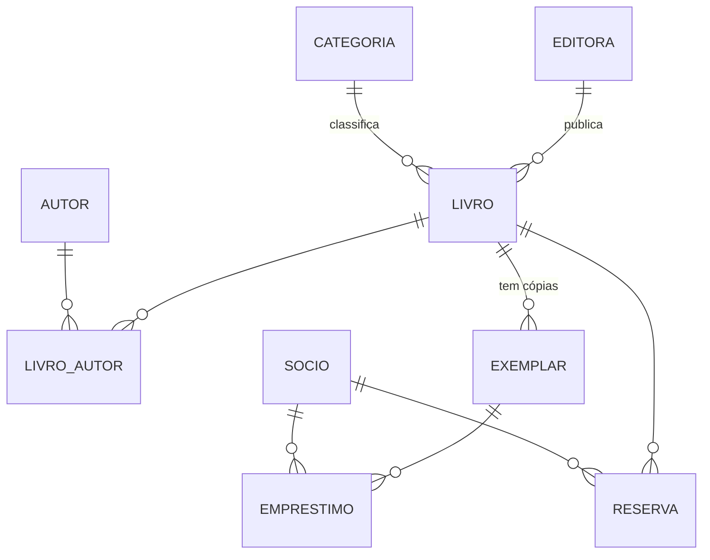

# Biblioteca Comunitária

Aplicação web em **Yesod (Haskell)** para gerenciar uma biblioteca comunitária: acervo, exemplares, sócios, empréstimos com multa por atraso e reservas. Arquitetura monolítica (Opção A do enunciado), com páginas em Shakespearean Templates (Hamlet e Lucius).

## Funcionalidades

- CRUD de livros, autores, editoras, categorias, exemplares, sócios, empréstimos e reservas pela interface web.
- **Importação de livro por ISBN** pela Open Library: título, autores, editora, ano, capa e trecho são gravados; editora e autores existentes são reaproveitados.
- **Endereço do sócio pelo CEP** via ViaCEP, gravado no cadastro.
- Empréstimo com prazo de 14 dias, limite de 3 abertos por sócio, multa de R$ 1,00 por dia de atraso e bloqueio de exemplar perdido ou já emprestado.
- Reservas para livros sem exemplar disponível, atendidas automaticamente no empréstimo, com aviso da fila na devolução.
- Busca de livros por título e categoria; filtros de empréstimos (abertos, atrasados, devolvidos).
- Login de bibliotecário com senha em hash (`yesod-auth-hashdb`); catálogo público e o resto restrito por papel.
- Validação de formulários com mensagens em português, proteção CSRF em todo POST e páginas de erro próprias.

## Tecnologias

| Camada | Ferramenta |
|---|---|
| Linguagem e framework | Haskell (GHC 9.10.3), Yesod 1.6 |
| Templates | Hamlet (HTML), Lucius (CSS), Bootstrap 3 |
| Banco | PostgreSQL 16, via Persistent (`persistent-postgresql`) |
| HTTP para as APIs | `http-conduit` + `aeson` |
| Build | Stack (snapshot lts-24.67, com warp 3.4.17 por segurança) |
| Testes | `hspec` + `yesod-test` |
| Ambiente | Docker Compose (Postgres), GitHub Actions (CI) |

## Como executar

Pré-requisitos: [Stack](https://docs.haskellstack.org/), Docker e a biblioteca cliente do Postgres (`sudo apt install libpq-dev` no Ubuntu/Debian).

```bash
docker compose up -d          # Postgres na porta 5433, bancos biblioteca e biblioteca_test
stack build                   # o primeiro build baixa o GHC e compila as dependências (demora)
stack exec biblioteca-seed    # opcional: dados de exemplo, só se o banco estiver vazio
stack exec biblioteca         # http://localhost:3000
```

O catálogo (livros, autores, editoras e categorias) é público. Sócios, empréstimos, reservas e qualquer alteração exigem login de bibliotecário. Para criar ou trocar a senha de um bibliotecário:

```bash
stack exec biblioteca-usuario -- maria   # pede a senha (mínimo 8 caracteres) sem mostrar na tela
echo "$SENHA" | stack exec biblioteca-usuario -- maria   # em script, a senha vem pela entrada padrão
```

- Testes: `stack test`.
- Recarregar ao editar: `stack install yesod-bin` e depois `stack exec -- yesod devel`.
- Outro banco: defina `YESOD_PGHOST`, `YESOD_PGPORT`, `YESOD_PGUSER`, `YESOD_PGPASS` e `YESOD_PGDATABASE` (veja `.env.example`).

### Frontend novo (`web/`, em construção)

O frontend em Next.js fala com a API do Yesod pelo servidor (BFF): o navegador só conversa com o Next.js, e o token da sessão fica num cookie `httpOnly`. Com a API rodando em `localhost:3000`:

```bash
cd web
npm ci
npm run dev                   # http://localhost:3001 (API_URL aponta para a API; padrão http://localhost:3000)
```

Por enquanto ele tem o login, a ativação da conta do sócio (`/ativar`), a vitrine do catálogo com busca e filtro por categoria (`/`), a página do livro com pedido e fila (`/livros/:id`), "Meus empréstimos" com renovação e cancelamento (`/emprestimos`) o painel do bibliotecário com números, pedidos, atrasados e devoluções do dia (`/painel`) o balcão com empréstimo em 3 passos e devolução pelo código (`/painel/balcao`), pedidos (`/painel/pedidos`), sócios (`/painel/socios`) e o acervo com livros, exemplares, importação por ISBN, autores, editoras e categorias (`/painel/acervo`); as outras telas chegam junto com os endpoints da API.

## Banco de dados

Nove tabelas do domínio, definidas em `config/models.persistentmodels` e criadas pela migração automática do Persistent ao subir a aplicação. (`user` e `email` vêm do scaffold do Yesod e não são usadas pelo domínio.)

| Tabela | Para que serve |
|---|---|
| `autor` | Autores, com nacionalidade |
| `editora` | Editoras (nome único) |
| `categoria` | Gêneros do acervo (nome único) |
| `livro` | A obra: título, ISBN (único), ano, sinopse, capa; FK para editora (opcional) e categoria |
| `livro_autor` | Junção N:N entre livro e autor, chave primária composta |
| `exemplar` | Cópia física de um livro: código único, estado (Bom, Danificado, Perdido) e disponibilidade |
| `socio` | Quem pega emprestado: e-mail único, telefone, CEP e endereço vindo do ViaCEP |
| `emprestimo` | Exemplar + sócio, datas de empréstimo, prevista e de devolução, multa em centavos |
| `reserva` | Fila de espera de sócio por livro, com status (Ativa, Atendida, Cancelada) |



As FKs são `ON DELETE RESTRICT` (o banco impede apagar o que ainda é referenciado), exceto `livro_autor → livro`, que é `CASCADE`.

## API REST

A API em JSON fica em `/api` e é a base do novo frontend (história 001). Ela autentica só pelo cabeçalho `Authorization: Bearer <token>`; o cookie do site não vale lá, e por isso a API dispensa o token CSRF.

| Método | Rota | Quem | Resposta |
|---|---|---|---|
| POST | `/api/sessoes` | todos | Corpo `{"login", "senha"}`. 201 com `token`, `expiraEm` (7 dias) e `usuario`; 401 se login ou senha não conferem |
| DELETE | `/api/sessoes` | com token | 204; o token deixa de valer |
| GET | `/api/eu` | com token | `{"login", "papel"}`; 401 sem token válido |
| POST | `/api/socios/:id/codigo-ativacao` | bibliotecário | 201 com `codigo` (formato `ABCD-2345`) e `expiraEm` (7 dias); um código novo invalida o anterior |
| GET | `/api/livros?busca=&categoria=` | público | `livros` (id, título, ano, capa, autores, categoria, `disponiveis`, `fila`) e `categorias`; a busca procura no título, no nome do autor e no ISBN, sem diferenciar maiúsculas |
| GET | `/api/livros/:id` | público | Detalhe com sinopse, editora, autores e exemplares (sem os perdidos); 404 em JSON se não existir |
| POST | `/api/livros/:id/pedidos` | sócio | Separa um exemplar e devolve `codigo` e `limiteRetirada` (48 h); 409 com o motivo se houver multa não paga, atraso, limite de 3 livros, livro repetido, fila de outra pessoa ou nenhum exemplar livre |
| DELETE | `/api/eu/pedidos/:id` | sócio | Cancela o próprio pedido e devolve o exemplar à estante |
| GET | `/api/eu/emprestimos` | sócio | Empréstimos (com atraso e multa), pedidos aguardando retirada, reservas com a posição na fila, `pendencias`, `emUso` e `limite` |
| POST | `/api/livros/:id/reservas` | sócio | Entra na fila quando não há exemplar livre; devolve a `posicao` |
| DELETE | `/api/eu/reservas/:id` | sócio | Sai da fila (só a própria reserva) |
| DELETE | `/api/reservas/:id` | bibliotecário | Cancela a reserva de qualquer sócio |
| POST | `/api/eu/emprestimos/:id/renovacao` | sócio | Renova uma vez por mais 7 dias; 409 se já renovado, atrasado, com multa ou atraso pendente, ou com fila para o livro |
| POST | `/api/emprestimos/:id/pagamento-multa` | bibliotecário | Registra o pagamento da multa (também pelo botão na página do empréstimo); libera pedidos e renovações |
| POST | `/api/pedidos/:id/retirada` | bibliotecário | Confirma a retirada no balcão e cria o empréstimo de 14 dias; 409 se o pedido venceu |
| GET | `/api/painel` | bibliotecário | `resumo` (abertos, exemplares, pedidos, atrasados com a multa prevista, devoluções de hoje) e as listas `pedidos`, `atrasados` e `devolucoesHoje` |
| GET | `/api/balcao/exemplares/:codigo` | bibliotecário | Exemplar pelo código (leitor ou teclado), com o livro e o empréstimo em aberto, se houver |
| POST | `/api/emprestimos` | bibliotecário | Corpo `{"socioId", "exemplarId"}`; empréstimo de 14 dias no balcão; 409 com o motivo (pendência, limite, exemplar indisponível ou perdido) |
| POST | `/api/emprestimos/:id/devolucao` | bibliotecário | Registra a devolução e devolve `multaCentavos` |
| POST | `/api/socios` | bibliotecário | Corpo `{"nome", "email", "telefone", "cep", "numero"}`; com CEP, o endereço vem do ViaCEP; e-mail único |
| GET / PUT / DELETE | `/api/socios/:id` | bibliotecário | Detalhe com empréstimos, reservas, pendências e se a conta do app está ativa; trocar o e-mail troca o login do app; só exclui sócio sem histórico (e apaga a conta do app junto) |
| GET | `/api/socios?busca=` | bibliotecário | Até 20 sócios por nome ou e-mail, com `emUso`, `pendencias` e `contaAtiva` |
| GET / POST | `/api/autores`, `/api/editoras`, `/api/categorias` | leitura pública, escrita do bibliotecário | Lista com a contagem de `livros`; criação com validação por campo (`400 {"erro", "campos"}`) e nome único para editora e categoria (409) |
| PUT / DELETE | `/api/autores/:id`, `/api/editoras/:id`, `/api/categorias/:id` | bibliotecário | Edita ou exclui; 409 ao excluir algo ligado a livros |
| POST / PUT / DELETE | `/api/livros`, `/api/livros/:id` | bibliotecário | Corpo `{"titulo", "isbn", "ano", "sinopse", "capaUrl", "editoraId", "categoriaId", "autores": [ids]}`; ISBN normalizado e único; não exclui livro com exemplares ou reservas |
| POST | `/api/livros/importacao` | bibliotecário | Corpo `{"isbn", "categoriaId"}`; busca na Open Library e cadastra livro, editora e autores |
| POST | `/api/livros/:id/exemplares` | bibliotecário | Corpo `{"codigo"?, "estado"}` (`bom`, `danificado`, `perdido`); sem código, gera `L<livro>-<n>` |
| PUT / DELETE | `/api/exemplares/:id` | bibliotecário | Edita código e estado; só exclui exemplar sem empréstimos nem pedidos |
| POST | `/api/ativacao` | público | Corpo `{"email", "codigo", "senha"}`. Cria a conta do sócio (ou troca a senha e encerra as sessões abertas); 400 se o código for inválido, vencido ou já usado, ou se a senha tiver menos de 8 caracteres |

Pedido não retirado em 48 h expira sozinho: a API confere os prazos ao listar e ao pedir, sem tarefa agendada.

O banco guarda só o hash SHA-256 do token (tabela `sessao`) e do código de ativação (tabela `codigo_ativacao`), nunca o valor em si. O código é de uso único e fica bloqueado depois de 5 tentativas erradas.

No site antigo, o bibliotecário também gera o código pelo botão **Gerar código de ativação** na página do sócio; o sócio ativa em `/ativar` no frontend novo.

## Integração com APIs

| API | Uso | Onde no código |
|---|---|---|
| [Open Library](https://openlibrary.org/dev/docs/api/books) | Em **Livros → Importar por ISBN**: busca o livro e grava título, autores, editora, ano, capa e trecho | `src/Integracao/OpenLibrary.hs`, `src/Handler/LivroImportar.hs` |
| [ViaCEP](https://viacep.com.br/) | No cadastro de **sócio**: com o CEP, grava logradouro, bairro, cidade e UF | `src/Integracao/ViaCep.hs`, `src/Handler/Socio.hs` |

Falhas de rede, timeout, ISBN ou CEP inexistente e respostas inesperadas viram mensagens para o usuário, sem erro 500.

## Organização do código

```
config/models.persistentmodels   entidades do banco
config/routes.yesodroutes        rotas
src/Handler/*.hs                 um módulo de handlers por entidade
src/Regras/*.hs                  regras de empréstimo e reserva, testáveis sem HTTP
src/Integracao/*.hs              clientes da Open Library e do ViaCEP
src/Form/Comum.hs                campos e páginas de formulário compartilhados
templates/                       Hamlet e Lucius por entidade
test/                            testes de handlers, regras e integrações
```

## Integrante

Trabalho individual: Leonardo (`leonardosf98`) — modelagem, backend Yesod, integrações, testes e documentação.

O planejamento por fases está no [ROADMAP.md](ROADMAP.md).
